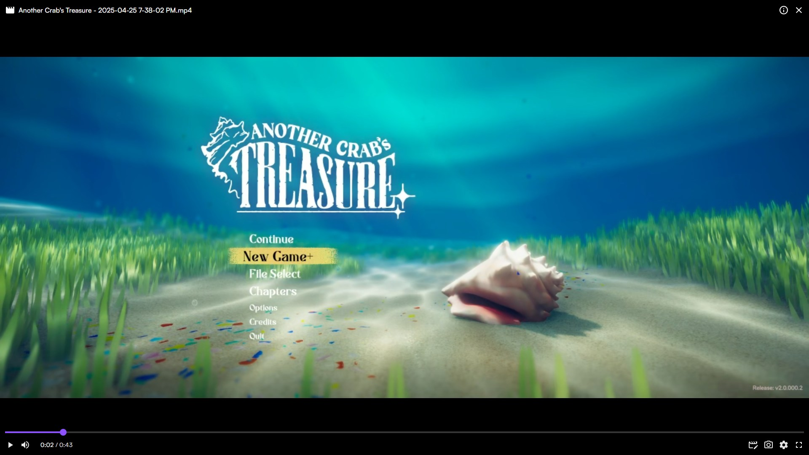
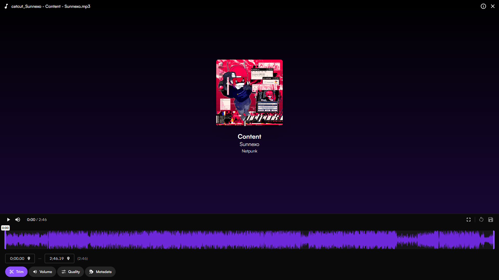

	

**catcut** is a webapp that allows you to quickly trim and edit videos in browser without uploading to a server, processed using [Mediabunny](https://mediabunny.dev).

## Contributing

Prerequisites for you: working knowledge of Svelte, Vite, and SvelteKit (which depends on knowing HTML, CSS, and JS).

Duplicate `.env.example` into `.env`. (optional)

Afterwards, run `bun install` (preferred) or `pnpm i`.
To run the development server, run `pnpm dev`.
